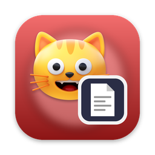
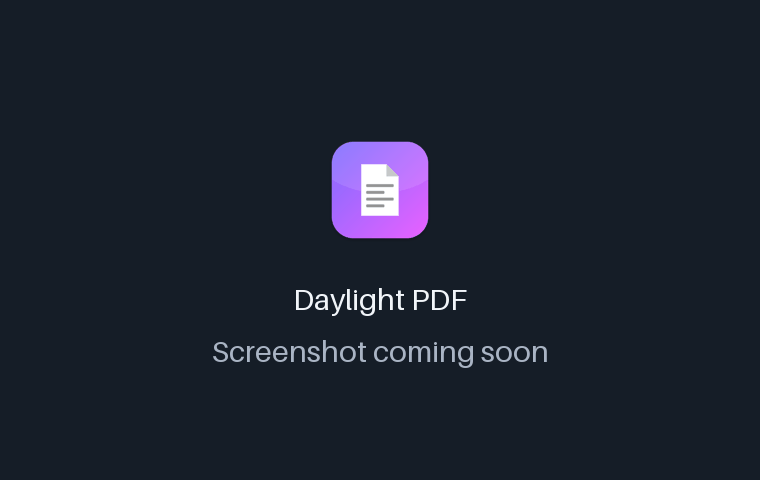
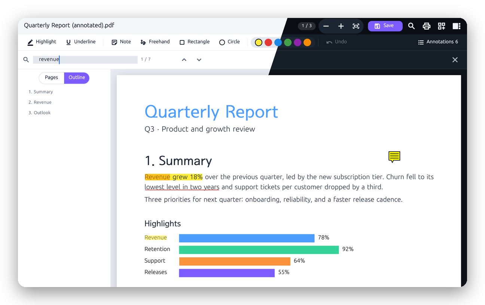
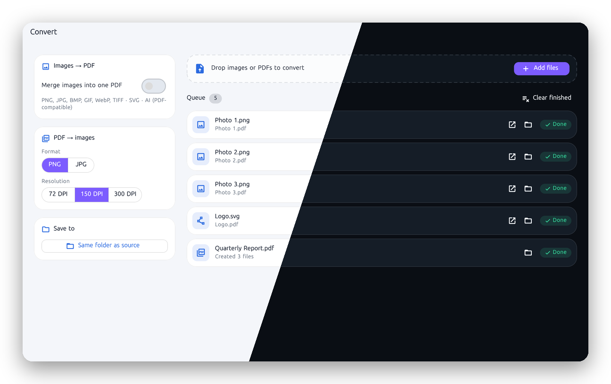
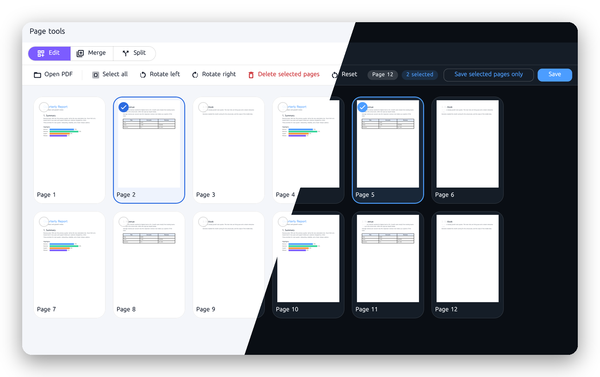
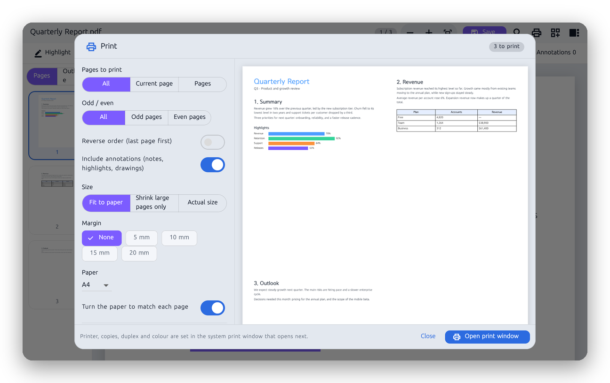

<!-- From jejezz/application-release-templates common/tool/readme @ conventions-v1. -->

<p align="center">
  
</p>

<h1 align="center">Daylight PDF</h1>

<p align="center">
  이미지·SVG·PDF 호환 <code>.ai</code>를 <b>PDF로 변환</b>하고, 보기·주석·페이지 조작까지 한곳에서 하는 데스크톱 앱.
</p>

<p align="center">
  <a href="https://github.com/jejezz/daylight-pdf-flutter/releases/latest"></a>
  <a href="https://github.com/jejezz/daylight-pdf-flutter/releases"></a>
  
  
  <a href="LICENSE"></a>
</p>

<p align="center">
  <a href="README.md">English</a> · <b>한국어</b>
</p>

<p align="center">
  
</p>

## 기능

- **변환** — PNG, JPG, BMP, GIF, WebP, TIFF, SVG, PDF 호환 `.ai`를 PDF로 (파일마다 하나씩, 또는 이미지를 한 PDF로 합쳐서), PDF 쪽을 72·150·300 dpi의 PNG·JPG로. 파일을 끌어다 놓으면 큐가 파일별 진행과 실패를 보여 줍니다.
- **보기** — PDFium으로 빠르게 그리고, 썸네일·목차 사이드바·글자 검색(`⌘F`)·너비/쪽/실제 크기 맞춤을 제공하며, 암호가 걸린 PDF는 암호를 물어봅니다. 최근 연 파일 10개는 홈 화면에서 바로 엽니다.
- **주석** — 형광펜, 밑줄, 메모, 손글씨, 사각형, 원을 여섯 색으로. `⌘Z`로 되돌리고, 메모를 누르면 내용을 읽고 고칠 수 있습니다. 주석은 표준 PDF 주석이라 다른 뷰어에서도 보이고, 메모는 자기 아이콘으로 보입니다.
- **페이지 도구** — PDF 합치기, N쪽마다 또는 범위로 나누기, 회전, 삭제, 끌어서 순서 바꾸기, 고른 쪽만 저장.
- **인쇄** — 쪽 범위, 홀수·짝수, 거꾸로, 주석 포함 여부, 맞춤/원래 크기, 여백, 용지, **한 장에 2/4/6/9쪽**, **소책자**, 쪽 번호, 워터마크, 흑백 강제를 미리보기로 확인하고, 프린터·매수·양면은 운영체제 인쇄 창에서 정합니다.
- **라이트·다크, 한국어·English** — 시스템 설정을 따르거나 툴바에서 고를 수 있습니다

<p align="center">
  
  
</p>
<p align="center">
  
  
</p>

## 설치

[**Releases**](https://github.com/jejezz/daylight-pdf-flutter/releases/latest)에서 받습니다.

| OS | 파일 |
|---|---|
| macOS 12.0 이상 | `DaylightPDF-<버전>-macos-universal.dmg` — 열어서 앱을 Applications 폴더로 끌어다 놓으세요 |
| Windows 10/11 (x64) | `DaylightPDF-<버전>-windows-x64-setup.exe` |
| Linux (x64) | `DaylightPDF-<버전>-linux-x64.tar.gz` — 압축을 풀고 `./install.sh` 실행 (`--remove`로 제거) |

**Windows:** 설치 프로그램에 아직 코드 서명이 없어서 SmartScreen이 "Windows의 PC 보호" 창을 띄웁니다. **추가 정보 → 실행**을 누르세요.

## 동작 방식

그리기, 쪽 조립, 주석은 모두 [PDFium](https://pdfium.googlesource.com/pdfium/)([pdfrx](https://pub.dev/packages/pdfrx) 경유) 위에서 돌아서, 합치기·나누기·주석을 해도 내용을 다시 인코딩하지 않습니다. 주석은 PDFium의 주석 API로 쓰고, 메모 아이콘은 SVG를 주석 자체의 모양으로 바꿔 넣기 때문에 다른 뷰어에서도 같은 모양으로 보입니다. 인쇄는 먼저 PDF를 준비하고(쪽 고르기, 배율과 여백, 모아 찍기·소책자 배열, 쪽 번호와 워터마크) 그 결과를 운영체제 인쇄 창에 넘깁니다.

알아 둘 점: 글자를 직접 고치는 기능은 없고, HEIC 이미지는 지원하지 않으며, `.ai`는 "PDF 호환 파일 만들기"로 저장된 것만 변환하고, 페이지 도구는 아직 암호가 걸린 PDF를 열지 못합니다.

## 개발

```bash
flutter pub get
flutter run -d macos
```

따로 설치할 것은 없습니다: PDFium은 `pdfrx`가 함께 가져옵니다. 단위 시험은 `flutter test`, 실제 PDF 엔진이 필요한 시험은 `integration_test/`에 있고 앱 안에서 한 파일씩 돕니다 (예: `flutter test integration_test/convert_test.dart -d macos`). 스크린샷은 `flutter test integration_test/readme_shots_test.dart -d macos` 다음에 `tool/readme/frame.py`와 `tool/readme/make_demo_gif.py`로 만듭니다.

릴리스: `scripts/bump-version.sh patch` → 병합 → `vX.Y.Z` 태그. CI가 모든 플랫폼을 빌드해서 올립니다. 규칙: [application-release-templates/conventions](https://github.com/jejezz/application-release-templates/tree/main/conventions).

## 크레딧

- 그리기: [PDFium](https://pdfium.googlesource.com/pdfium/) ([pdfrx](https://pub.dev/packages/pdfrx) 경유)
- 글꼴: [서울남산체](https://www.seoul.go.kr/seoul/font.do) (서울특별시)
- 아이콘: [Icons8](https://icons8.com)

## 라이선스

[MIT](LICENSE) © 2026 Jongyun Ahn
